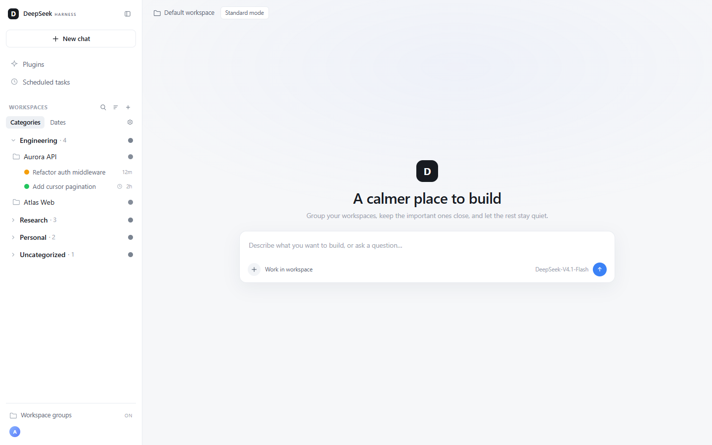
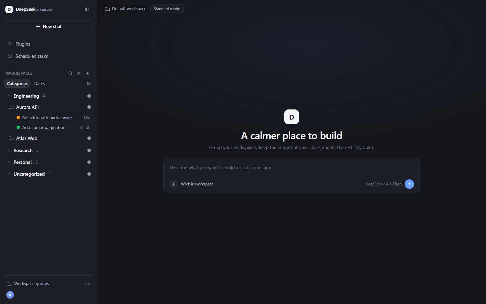
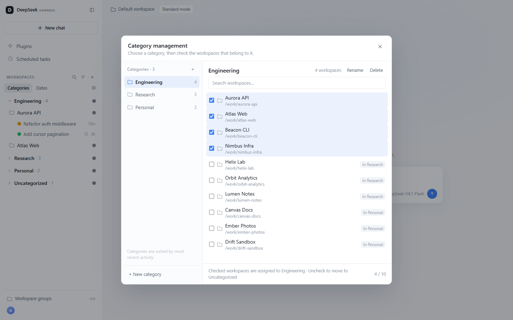
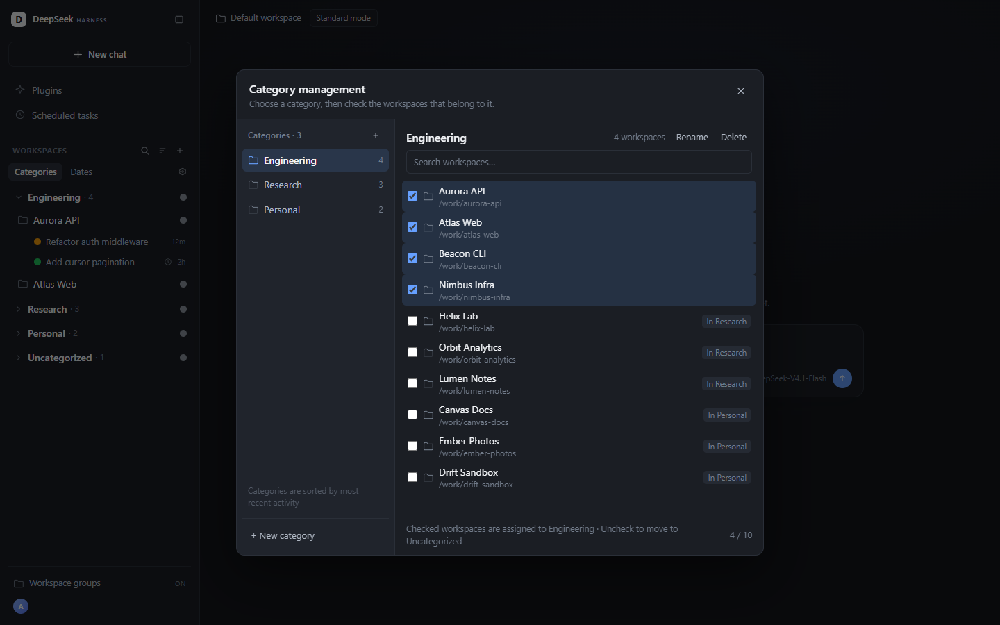
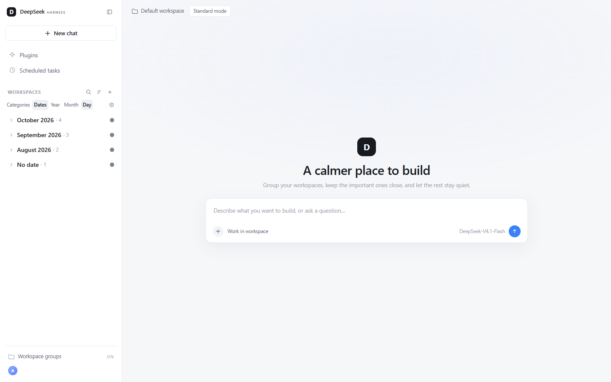
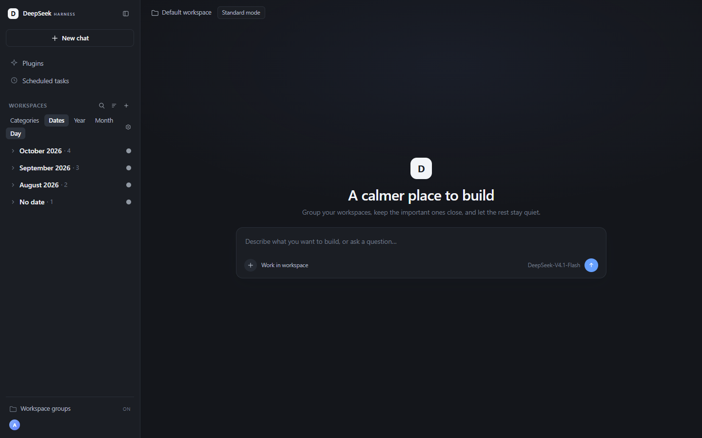

# dsh-workspace-classifier

[English](README.en.md) | 简体中文

给 **DeepSeek Harness** 在侧边栏的原生工作区列表增加一层分类，保留原生会话行和交互不变。简单的小功能，可以让你的harness项目管理更方便点。

**0.1.1** · MIT · DSH `>= 0.2.0-rc.2`

> 文档截图使用虚构工作区名和路径。

> 代码由AI辅助完成。

## 功能

- **两种分组**：分类 / 日期。
- **两种分隔风格**：分区带 / 分组卡片，可在分类管理弹窗底部切换。
- **自定义分类**：新建、重命名、删除，勾选工作区归属。
- **日期分组**：按创建时间自动分为年 / 月 / 日，默认折叠。
- **分类排序**：拖动分组头，或在管理弹窗用「上移 / 下移」。
- **折叠状态**：自定义分类保留上次状态；日期分组每次重新进入都从折叠开始。
- **自动折叠不活跃工作区**：没有会话、或超过一周未更新的工作区，会在原分类/日期分组内折叠为「N 不活跃」；点它就地展开，不额外拆分分类。
- **特殊分组**：未分类、无固定工作区也可折叠和归类。
- **提示点**：汇总提醒、主智能体/子智能体正在运行的会话和定时任务。
- **原生标题栏开关**：一键关闭分类层，恢复原生列表。

## 预览

| 视图 | 浅色 | 深色 |
| --- | --- | --- |
| 分类 |  |  |
| 分类管理 |  |  |
| 日期分组 |  |  |

## 安装

需要 DSH `>= 0.2.0-rc.2`，并能在终端使用 `dsh` 命令。

Windows PowerShell 一键安装：

```powershell
irm https://raw.githubusercontent.com/YuyuYuu-wyt/dsh-workspace-classifier/main/install.ps1 | iex
```

或者手动：

```powershell
git clone https://github.com/YuyuYuu-wyt/dsh-workspace-classifier.git
cd dsh-workspace-classifier
dsh plugin --profile desktop add "link:$PWD"
```

安装后刷新 DSH（`Ctrl+Shift+R`），侧栏「工作区」标题行右侧会出现分类图标。

卸载：

```bash
dsh plugin --profile desktop remove dsh-workspace-classifier
```

## 使用

1. 点击「工作区」标题行右侧的分类图标开启分类层。
2. 在「分类 / 日期」之间切换；日期模式可选年 / 月 / 日。
3. 点击齿轮管理分类和工作区归属。
4. 点击分组头折叠或展开。
5. 再次点击标题栏分类图标恢复原生列表。

## 兼容

不替换原生侧边栏槽位，不改写官方包，不影响原生会话行。依赖 DSH 原生工作区列表的 DOM 结构，DSH 大版本升级后可能需要适配。

## License

MIT。见 [LICENSE](LICENSE)。
